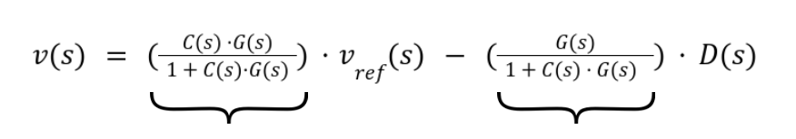

# Introduction

In this project, we are modeling a vehicle moving forward subject to
aerodynamic drag (b), mass (m),throttle force (u) and road slope
disturbances (𝜃)

In this project, we have

1.  Modeled an open loop response

> $G(s)\  = \ \frac{V(s)}{U(s)}$

2.  Designed a PID controller to control 65 mph regardless of severe
    > uphill/downhill gradient changes

3.  Compare open loop control against three feedback control
    > architectures

    a.  Proportional controller ($P$)

    b.  Proportional Integral controller ($PI$)

    c.  Proportional-Integral-Derivative Controller ($PID$)

4.  Compare standard PID against Gain Scheduling

# Basics

This is the situation we've modeled where the car is the black box in
the picture and it is inclined at an angle theta to the horizontal
ground.

  
   
  <em>Figure 1: Vehicle on inclined road angle θ.</em>

{width="6.5in" height="3.513888888888889in"}

Figure 2 : This is a free body diagram of the model showing all the
forces that has been accounted for

# Time domain differential equation 

The total force accelerating the vehicle of mass m consists of engine
force $u(t)$, aerodynamic drag / friction damping force $b \cdot \ v(t)$
and external gravity disturbance $d(t)$

$m\ \frac{dv}{dt}\  = \ u(t)\  - \ b \cdot v(t)\  - \ d(t)$

In our case we have assumed

1.  Mass (m) = 1000 kg

2.  b = 50 $\frac{N\  \cdot \ s\ }{m}$

3.  $v(t)\ $= vehicle speed ($\frac{m}{s})$

4.  $u(t)$ = engine force $(N)$

5.  $d(t)$ = external force resistance $(N)$

# Laplace Transform to Transfer Function $G(s)$

Assuming zero initial conditions $(v(0)\  = \ 0),$ and taking the
laplace transform converts differential equations into algebraic
equations:

$m \cdot s \cdot v(s)\  + \ b \cdot v(s)\  = \ U(s)\  - \ D(s)$

$\ \ \ \ \ \ (m \cdot s\  + \ b)v(s)\  = \ U(s)\  - \ D(s)$

Now defining the plant transfer function $G(s)$ as ratio of speed output
$V(s)$ to input force $U(s)$(with zero disturbance).

$G(s)\  = \ \frac{v(s)}{U(s)}\  = \ \frac{1}{m \cdot s\  + \ b}$

Substituting the values

$G(s)\  = \ \frac{1}{1000 \cdot s\  + \ 50}$

Key system characteristics:

1.  System pole :- $s\  = \  - \frac{b}{m}\  = \  - 0.05\ rad/s$ which
    > is located in the left half plane guaranteeing open-loop stability

2.  Time constant $(\tau)$ : $\tau\  = \ \frac{m}{b}\  = \ 20\ seconds$

    a.  Time taken to reach $63.2\ \%$ of step response = 1 $\tau$ = 20
        > seconds

    b.  Time to settle within $98\ \%$ of step response = 4 $\tau$ = 80
        > second

3.  DC gain $(K_{plant}\ )$ =
    > $K_{plant}\  = \ \lim_{s \rightarrow 0}G(s)\  = \ \frac{1}{b}\  = \ 0.02\ \frac{(m/s)}{N}$

# Disturbance Force Physics (d)

When driving on flat ground, the angle of inclination equals zero. Thus,
$\theta\  = \ 0$.

We have accounted the vehicle at an inclination of $5$ degrees (which is
just a parameter and can be changed).

Thus on the incline, the gravity pulls the vehicle down with a force of

$d\  = \ mgsin(\theta)$

Substituting in the values

$d\  = \ 1000\  \cdot \ 9.81\  \cdot \ sin(5)$

$d\  = \ 855.28\ N$

# Open Loop and its failures 

In open loop, engine force $u(t)$ is set manually to match the set flat
ground friction so that the vehicle moves at a constant speed of
$30\ \frac{m}{s}$.

Substituting $d\  = \ 0$ in the FBD equation in the steady state along
with the other parameters, we get :

$u_{flat}\  = \ b\  \cdot \ v_{ref}\  = \ 50\  \cdot \ 30\  = \ 1500\ N$

Steady state value is basically $\lim_{t \rightarrow \infty}v(t)$

Which according to final value theorem equals
$\lim_{s \rightarrow 0}s \cdot v(s)$

Thus

$\lim_{s \rightarrow 0}s\  \cdot \frac{(G(s)\  \cdot u_{net})}{s}\ $ $$

$= \ G(0)\  \cdot u_{net}$

$= \ \frac{u_{net}}{b}$

1.  For a flat ground $u_{net\ }\  = \ 1500\ N\ $. Thus

${v\  = \ \frac{1500}{50}\  = \ 30\ m/s}_{}$

2.  On a 5 degree hill,
    > $u_{net}\  = \ 1500\  - \ 855.28\  = \ 644.72\ N$

> $v\  = \ \frac{644.72}{50}\  = \ 12.89\ m/s$

**Conclusion:** Open-loop control cannot react to unmodeled disturbances
like hills because it does not measure actual speed output.

# Closed-Loop Feedback & Superposition

To correct errors automatically, closed loop feedback measures output
v(t), subtracts it from reference velocity (i.e. 30 m/s) to calculate
the error e(t)

$e(t)\  = \ v_{ref}(t)\  - \ v(t)$

and then feeds $e(t)$ into a controller $C(s)$.

{width="6.5in" height="2.763888888888889in"}

Derivation of closed loop Dynamics

Total plant input = $U(s)\  - \ D(s)$ where
$U(s)\  = \ C(s)\  \cdot \ E(s)$ and $E(s)\  = \ v_{ref}(t)\  - \ v(t)$.

$v(s)\  = \ G(s) \cdot \lbrack C(s) \cdot ({v_{ref}(s)\  - \ v(s))\  - \ D(s)\rbrack}^{}$

$v(s)\  + \ C(s) \cdot G(s) \cdot v(s)\  = \ C(s) \cdot G(s) \cdot v_{ref}(s)\ \  - \ G(s) \cdot D(s)$

$v(s) \cdot \lbrack 1\  + \ C(s) \cdot G(s)\rbrack\  = C(s) \cdot G(s) \cdot v_{ref}(s)\ \  - \ G(s) \cdot D(s)\ $

{width="4.359375546806649in"
height="0.7594389763779528in"}

> $T_{ref}(s)$ $T_{dist}(s)$

As the system is LTI, thus using principle of superposition, total
response is the linear sum of :

1.  Setpoint Response ${{(y}_{ref})}^{}\ $: Response to speed target
    > change.

2.  Disturbance Response ($y_{dist}$) : Response to gravity resistive
    > force.

and thus $v(t)$ can be found by taking the inverse laplace
transformation of the total velocity.

# Controller Anatomy ($P$, $PI$, $PID$)

Proportional Controller ($P$) :

$C_{p}(s)\  = \ {K_{p}}_{}^{}$

Mechanism : Engine thrust is directly proportional to current speed
error $(u(t)\  = \ K_{p\ } \cdot \ e(t))$

Transfer Functions :

$T_{ref}(s) = \frac{K_{p}\frac{1}{ms + b}}{1 + K_{p}\frac{1}{ms + b}} = \frac{K_{p}}{ms + (b + K_{p})}$

Effect : Effective damping increases from $b \rightarrow b + K_{p}$,
speeding up acceleration\
($\tau_{closed\_ loop} = \frac{m}{b + K_{p}}$).

Limitation (Steady-State Error) :

$e_{ss} = \frac{1}{1 + K_{p}K_{plant}} \neq 0$

As long as error $e(t) = 0$, engine force $u(t) = 0$. Since force is
required to fight drag/gravity, error can never be zero with P control
alone.

### Proportional-Integral Controller ($PI$)

$C_{PI}(s) = K_{p} + \frac{K_{i}}{s} = \frac{K_{p}s + K_{i}}{s}$

-   Mechanism : Integrates error over time
    > ($u(t) = K_{p}e(t) + K_{i}e(\tau)d\tau$).

-   System Type : Adds a pole at the origin ($s = 0$), raising the
    > system from Type 0 to Type 1.

-   Effect : Guarantees zero steady-state error ($e_{ss} = 0$). Even if
    > $e(t) = 0$, the integral term holds memory of past error to
    > sustain engine force against friction/gravity.

-   Trade-off : Introduces phase lag, causing transient velocity
    > overshoot.

### Proportional-Integral-Derivative Controller ($PID$)

$C_{PID}(s) = K_{p} + \frac{K_{i}}{s} + K_{d}s = \frac{K_{d}s^{2} + K_{p}s + K_{i}}{s}$

-   Mechanism : Adds a derivative term measuring rate of error change
    > ($u(t) = K_{p}e(t) + K_{i}e(\tau)d\tau + K_{d}\frac{de(t)}{dt}$).

-   Effect : Adds a zero in the open-loop transfer function, introducing
    > \"electronic damping\" or predictive action.

-   Result : Suppresses overshoot from integral action, yielding rapid
    > acceleration, zero steady-state error, and fast recovery from hill
    > disturbances.

# Project Directory Structure

cruise-control-simulation/

├── config/

│ └── parameters.py \# Physical constants (mass, damping, v_ref,
controller gains)

├── src/

│ ├── plant.py \# Transfer function G(s) and gravity disturbance force d

│ ├── controllers.py \# Transfer functions for P, PI, and PID
controllers

│ └── metrics.py \# Quantitative metric library (rise time, overshoot,
IAE)

├── scripts/

│ └── run_closed_loop.py \# Closed-loop simulation and comparison
plotting

│ └── run_open_lloop.py \# open-loop simulation

├── assets/

│ └── closed_loop_comparison.png \# Generated benchmark plots

│ └── open_loop_step.png \# Generated benchmark plots

├── requirements.txt \# Project dependencies

└── README.md \# System documentation

# Installation & Quickstart

1\. Clone Repository & Setup Virtual Environment

git clone
[[https://github.com/your-username/cruise-control-simulation.git]{.underline}](https://github.com/your-username/cruise-control-simulation.git)

> cd cruise-control-simulation
>
> python3 -m venv controlenv
>
> source controlenv/bin/activate
>
> pip install -r requirements.txt

2\. Run Closed-Loop Simulation

python -m scripts.run_closed_loop

{width="0.4791666666666667in"
height="6.25e-2in"}
